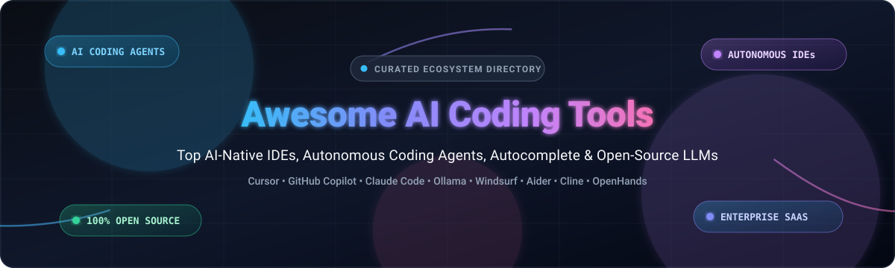

# ⚡ Awesome AI Coding Tools

  

  
  
  
  
  
  
  

> 🚀 A curated directory of the best **AI Coding Tools**, **AI-Powered Code Editors**, **Autonomous Coding Agents**, **Code Completion Extensions**, and **Self-Hosted Open-Source LLM Developer Tools**.

---

## 📑 Table of Contents

- [📊 Sector Overview & Market Dynamics](#-sector-overview--market-dynamics)
- [💼 Top SaaS / Hosted AI Coding Platforms](#-saas--hosted-platforms)
- [🔓 Top Open-Source AI Coding Projects](#-open-source-github-projects)
- [🏗️ Architecture & Frameworks for Custom AI Coding](#️-architecture--frameworks-for-custom-ai-coding)
- [⭐ Star History](#-star-history)
- [💖 Support & Sponsorship](#-support--sponsorship)
- [🤝 How to Contribute](#-how-to-contribute)
- [⚠️ Disclaimer](#️-disclaimer)

---

## 📊 Sector Overview & Market Dynamics

The global AI code assistant and developer productivity market was valued at approximately **$4.1 billion to $4.6 billion in 2025–2026** and is projected to surpass **$21 billion to upwards of $78 billion by 2030–2032**, expanding at a rapid compound annual growth rate (CAGR) of **25%–35%** 📈. 

The sector currently demonstrates **moderate fragmentation with strong consolidation pressure at the frontier**: while foundational platform incumbents like Microsoft/GitHub and Amazon command massive enterprise market share through distribution advantages, aggressive venture-backed innovators (such as Cursor / Anysphere, Codeium / Exafunction, and Cognition) and transparent, privacy-first open-source ecosystems (Ollama, OpenHands, Cline, Continue) prevent a complete single-vendor "winner-take-all" outcome 🌐.

---

## 💼 SaaS / Hosted Platforms

Below is a curated comparison of leading commercial AI coding platforms, sorted in descending order by parent company scale (valuation or enterprise revenue) 🏢.

| 🛠️ Platform | 🏷️ Valuation / Company Scale | 💳 Starting Pricing | 🎁 Free Tier Limits / Free Trial | 🌟 Key Capabilities & Overview |
| :--- | :--- | :--- | :--- | :--- |
| **[Amazon Q Developer](https://aws.amazon.com/q/developer/)** | ~$2.2T+ Market Cap (Amazon AWS) | **$19/user/month** (Pro Tier) | Free forever plan with limits: 2,000 code suggestions/user/month, 50 chat queries/month, and 5 workspace code transformations per month. | Enterprise AWS coding assistant deeply integrated with IDEs, terminal, AWS Console, security scanning, and autonomous Java version upgrades. |
| **[GitHub Copilot](https://github.com/features/copilot)** | ~$3.1T+ Market Cap parent (Microsoft / GitHub: $2B+ ARR) | **$10/month** or $100/year (Copilot Pro) | Free forever plan with limits: 2,000 code completions/month, 50 chat messages/month, multi-file editing support, and Claude 3.5 Sonnet / GPT-4o choice. | Industry-standard AI coding assistant with universal IDE coverage (VS Code, Visual Studio, JetBrains, Neovim) and full GitHub integration. |
| **[Replit AI](https://replit.com/ai)** | ~$3.0B Valuation ($50M+ ARR) | **$25/month** or $240/year (Replit Core) | Free forever plan with limits: Basic public cloud workspaces, basic code completion, and a 14-day free trial of Replit Core (with Agent checkpoint credits). | Cloud-native collaborative IDE featuring full-stack autonomous application generation, instant web deployment, and browser-based coding agents. |
| **[Cursor](https://cursor.com/)** | ~$2.5B Valuation (Anysphere: $100M+ ARR) | **$20/month** (Cursor Pro) | Free forever plan with limits: 14-day free trial of Pro, followed by 2,000 completions, 50 slow premium requests/month, and 200 standard requests. | AI-native fork of VS Code offering semantic codebase indexing, multi-file composer diffing, intelligent inline autocomplete, and agentic terminal control. |
| **[Windsurf (Codeium)](https://codeium.com/windsurf)** | ~$1.25B Valuation (Exafunction) | **$15/month** (Pro Tier) | Free forever plan with limits: Unlimited standard autocomplete, 100 fast premium chat/Flow prompts/month, and unlimited slow model queries. | Agentic IDE pioneering "Flows" and multi-step Cascade coding agents with deep repository context, autonomous terminal actions, and multi-file edits. |
| **[Codeium](https://codeium.com/)** | ~$1.25B Valuation (Exafunction) | **$15/user/month** (Teams Tier) | Free forever plan with limits: Unlimited rapid code completions, unlimited standard chat, and integrated in-IDE repository indexing for individual devs. | High-speed multi-IDE plugin offering autocomplete and natural language chat with zero individual subscription cost and low-latency inference. |
| **[Sourcegraph Cody](https://sourcegraph.com/cody)** | ~$1.0B Valuation (Sourcegraph) | **$9/user/month** (Cody Pro) | Free forever plan with limits: 200 chat messages/month and 500 code autocompletions/month across multiple leading models. | Codebase-aware coding assistant leveraging Sourcegraph’s code graph intelligence for large multi-repo architectures and custom LLM routing. |
| **[Tabnine](https://www.tabnine.com/)** | ~$300M Valuation (~$15M+ ARR) | **$12/user/month** (Pro Tier) | Free forever plan with limits: Basic short single-line code completions for solo developers, plus a 90-day free trial of the Pro tier. | Privacy-centric AI code completion supporting isolated on-premise deployments, zero customer data retention guarantees, and air-gapped security. |
| **[Supermaven](https://supermaven.com/)** | ~$100M Valuation (Acquired by Cursor) | **$10/month** or $100/year (Pro Tier) | Free forever plan with limits: Standard code completion model with a 7-day free trial of the 1,000,000-token Babble context model. | Ultra-low latency code completion engine powered by a bespoke 1M token context architecture for instant response times. |
| **[Continue](https://www.continue.dev/)** | Early Stage / Venture-Backed ($5M+ Seed) | **$20/user/month** (Continue Hub Team) | Free forever open-source core: Unlimited local/self-hosted model usage (Ollama/vLLM) and free Hub tier with community configurations. | Extensible open-core developer platform for configuring custom LLMs, context providers, docs indexing, and team-wide prompt systems inside VS Code/JetBrains. |

---

## 🔓 Open-Source GitHub Projects

Explore top-rated open-source developer tools, CLI pair programmers, autonomous software engineers, and local runtimes. Repositories are ranked in descending order by GitHub stars ⭐.

| 📦 Repository | ⭐ GitHub Stars | 📝 Description |
| :--- | :--- | :--- |
| **[Ollama](https://github.com/ollama/ollama)** |  | High-performance local LLM execution runtime. Powers privacy-first code completion and offline coding models (DeepSeek-Coder, Qwen2.5-Coder, Codestral, Llama 3). |
| **[Open WebUI](https://github.com/open-webui/open-webui)** |  | Feature-packed self-hosted web interface supporting Ollama, vLLM, and OpenAI-compatible APIs with built-in code execution, RAG, and artifact rendering. |
| **[Claude Code](https://github.com/anthropics/claude-code)** |  | Anthropic's agentic coding companion that operates directly inside your terminal, understands whole repos, runs CLI commands, and automates git workflows. |
| **[Gemini CLI](https://github.com/google-gemini/gemini-cli)** |  | Open-source terminal agent bringing Google Gemini's multimodal reasoning and massive 2M-token context window directly into command-line development. |
| **[OpenHands](https://github.com/OpenHands/OpenHands)** |  | Autonomous AI software engineer platform (formerly OpenDevin) capable of writing code, browsing the web, executing bash commands, and resolving GitHub issues end-to-end. |
| **[MetaGPT](https://github.com/FoundationAgents/MetaGPT)** |  | Multi-agent collaboration framework that simulates an entire software engineering team (Product Managers, Architects, Project Managers, and Engineers) from a single prompt. |
| **[Cline](https://github.com/cline/cline)** |  | Autonomous coding agent extension for VS Code that reads repositories, executes shell commands, inspects browser views, and creates multi-file patches with human-in-the-loop review. |
| **[Goose](https://github.com/aaif-goose/goose)** |  | Open-source on-machine AI agent from Block that automates complex engineering tasks, scripts system interactions, and integrates via Model Context Protocol (MCP). |
| **[GPT-Engineer](https://github.com/AntonOsika/gpt-engineer)** |  | CLI tool that builds entire codebases from natural language specifications and iterates based on user prompts (the foundation behind Lovable.dev). |
| **[Aider](https://github.com/Aider-AI/aider)** |  | Premier AI pair programming tool in the terminal with git repository map awareness, multi-file refactoring, automatic git commits, and benchmark-leading code editing. |
| **[LibreChat](https://github.com/LibreChat-AI/LibreChat)** |  | Enhanced open-source AI platform supporting multiple model providers, custom coding agents, code syntax highlighting, MCP integration, and team management. |
| **[Continue](https://github.com/continuedev/continue)** |  | Open-source modular coding assistant extension for VS Code and JetBrains. Connects any open or proprietary LLM with custom docs, codebase indexing, and slash commands. |
| **[Tabby](https://github.com/TabbyML/tabby)** |  | Self-hosted, standalone AI coding assistant server offering high-speed code completion and chat with on-premise GPU/CPU acceleration. |
| **[Roo Code](https://github.com/RooCodeInc/Roo-Code)** |  | Agentic coding extension for VS Code featuring custom persona modes (Code, Architect, Ask, Debug), MCP tool integration, and checkpoint rollbacks. |
| **[Devika](https://github.com/stitionai/devika)** |  | Agentic software development assistant that breaks down high-level human goals into research, architecture, and code execution steps. |
| **[Plandex](https://github.com/plandex-ai/plandex)** |  | Terminal-based AI coding engine architected for large, multi-file software engineering tasks with version-controlled sandboxes and diff reviews. |
| **[Sweep](https://github.com/sweepai/sweep)** |  | Open-source GitHub assistant that turns bug reports and feature requests into tested pull requests automatically. |
| **[Twinny](https://github.com/twinnydotdev/twinny)** |  | Privacy-focused AI code completion and chat extension for VS Code designed specifically for local LLMs via Ollama, LM Studio, or llama.cpp. |

---

## 🏗️ Architecture & Frameworks for Custom AI Coding

For enterprise engineering teams evaluating local vs. commercial deployments:

1. ⚙️ **Inference Runtime Engine**: Deploy [Ollama](https://github.com/ollama/ollama), [vLLM](https://github.com/vllm-project/vllm), or [llama.cpp](https://github.com/ggerganov/llama.cpp) for private, zero-data-leakage model execution.
2. 🧠 **Context & Embedding Indexing**: Leverage tools like [Continue](https://github.com/continuedev/continue) or [Tabby](https://github.com/TabbyML/tabby) to generate vector embeddings and AST repository maps of your local git repository.
3. 💻 **Editor / Terminal Client**: Integrate [Aider](https://github.com/Aider-AI/aider) or [Claude Code](https://github.com/anthropics/claude-code) for terminal workflows, or [Cline](https://github.com/cline/cline) / [Continue](https://github.com/continuedev/continue) in VS Code / JetBrains.
4. 🔌 **Agent Protocol & Tools**: Standardize external tool communication and API integrations using the [Model Context Protocol (MCP)](https://modelcontextprotocol.io/).

---

## 📈 Star History

---

## 💖 Support & Sponsorship

Thank you so much for exploring and supporting **Awesome AI Coding Tools**! 🙏

If you found this repository helpful, consider supporting its continuous maintenance:
- ⭐ **Star this repository** on GitHub to help others discover it!
- 🍴 **Fork and share** with fellow developers, teams, and open-source communities.
- ☕ **Buy me a coffee / Sponsor**: If you'd like to support ongoing updates, research, and curation, please consider sponsoring via the [GitHub Sponsor Dashboard](https://github.com/sponsors/ishandutta2007) ❤️.

---

## 🤝 How to Contribute

Contributions are warmly welcomed! To suggest a tool, update pricing, or add an open-source project:

1. 🍴 Fork this repository.
2. ✍️ Update `README.md` following the table schema:
   - For SaaS tools: include company valuation/scale, exact starting tier price, and explicit free tier or trial limits.
   - For Open-Source projects: provide the GitHub repository, star badge (`style=social&color=white`) linking to its stargazers page, and a concise 1–2 sentence description.
3. 🚀 Submit a Pull Request with a short summary of the updates.

---

## ⚠️ Disclaimer

This repository is maintained for informational and educational purposes. Product pricing, free tier limits, company valuations, and repository star metrics are subject to continuous change by their respective maintainers and vendors. Always verify security, data privacy, and intellectual property compliance prior to deploying AI coding tools in enterprise environments.

---

  <b>Star ⭐ this repository to stay updated on the latest breakthroughs in AI-assisted software development!</b>

